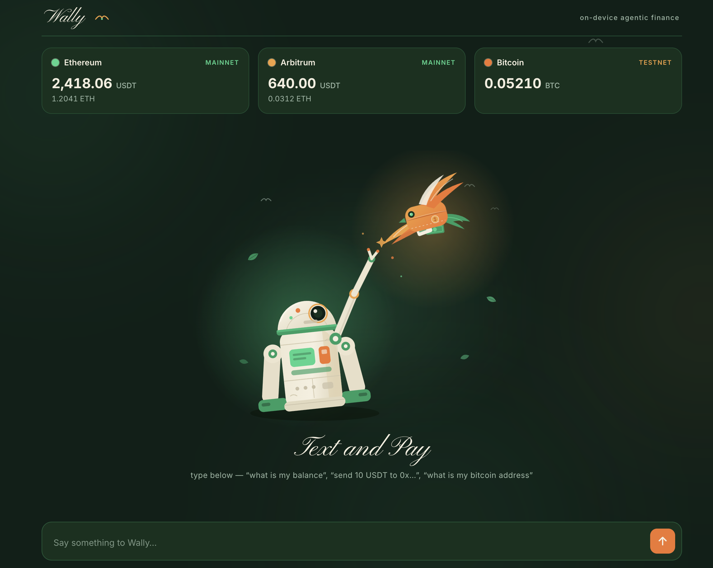

# Wally

Phone-local QVAC integration and performance testing: [Android phone test setup and current hardware limitations](docs/QVAC-PHONE-TESTING.md). The native path is prepared; physical-device inference and APK compilation remain unverified.

A crypto wallet you talk to. The AI runs on your machine. The keys never leave it either.



You type plain English. Wally understands it with a local model, quotes the fee, asks you to confirm, and executes on-chain. No cloud AI, no API keys, no custodian.

- **USDT in, USDT out, fees in USDT.** Wally's home chain is Arbitrum with an ERC-4337 smart account: you hold USDT, you send USDT, and the network fee is paid in USDT. The wallet never needs to hold ETH. ([setup](GASLESS.md))
- **Local intelligence.** [QVAC](https://qvac.tether.io), Tether's on-device AI runtime, runs a quantized Qwen3 4B on your laptop, served through the QVAC CLI's OpenAI-compatible HTTP server. With the default loopback setup your messages never leave the machine to be understood; pointing at a remote QVAC server is an explicit opt-in that requires https and an API key.
- **Local keys.** [WDK](https://wdk.tether.io), Tether's Wallet Development Kit, derives your wallet from a seed phrase and signs locally. Only signed transactions touch the network.
- **A human gate on every spend.** The AI proposes a transaction. Nothing moves until you press CONFIRM inside a 60 second window.
- **Chained DeFi from one sentence.** "Deposit 200 USDT into Aave and borrow at 50% LTV" runs the whole chain (approve, deposit, borrow) as one confirmed plan. If you leave out the loan-to-value, Wally asks for it. The borrow amount is computed in code from live prices and capped below the liquidation threshold; the model parses your words but never picks the numbers. Afterwards, ask "how safe is my loan" any time for a live health-factor readout with an on-chain proof link.

## Local UI simulation

Run `npm run dev:sim` and open http://127.0.0.1:3000. Node.js is the only requirement; this preview uses fictional balances and scripted replies, with no wallet keys, AI model, or blockchain access. See [the local feature review](docs/LOCAL-DEV-REVIEW.md) for tested flows and implementation gaps.

## Run it in five minutes

**You need:** Node.js 22+, and [QVAC](https://qvac.tether.io) installed with a downloaded model (Qwen3 4B or larger).

```bash
git clone https://github.com/victorchimakanu/wally.git
cd wally
npm install
cp .env.example .env.local
```

**Your wallet.** You do not need to create one by hand. The first time you start Wally
with no seed configured, it generates a fresh wallet for you and shows you the recovery
phrase once, on screen, to write down. It is stored locally in a gitignored `.wally-seed`
file (owner-only) and reused on every later start. Each person who runs their own copy of
Wally gets their own wallet; nobody shares funds.

If you would rather bring your own seed, set one in `.env.local` and Wally uses it instead:

```bash
WDK_SEED=your twelve or twenty-four word phrase   # optional; omit to auto-create
```

For production, prefer `WDK_SEED_COMMAND` or `WDK_SEED_FILE` over a plaintext seed.

**Start the QVAC model server.** Wally talks to QVAC over the OpenAI-compatible API
(`qvac serve openai`, port 11434, the same interface ollama exposes). Edit
the config so the model `src` points at a `.gguf` file under `~/.qvac/models/`:

```bash
cp qvac.config.example.json qvac.config.json   # gitignored, like wdk.config.json
```

Then:

```bash
qvac serve openai -c qvac.config.json
```

Because Wally is just an OpenAI-style client pointed at `QVAC_SERVER_URL`, the model can
run on this machine or on any server you control. Switching is a one-line URL change in
`.env.local`.

Start Wally in a second terminal:

```bash
npm run dev
```

Open [http://localhost:3000](http://localhost:3000). The first message takes a few extra seconds while the model loads.

**To send USDT without ever touching ETH** (the default Wally experience), do the ten minute [gasless setup](GASLESS.md): one JSON config file with a free bundler/paymaster key, and one `WDK_CONFIG` line in `.env.local`. That's it — every chain configured with a bundler and paymaster switches to a smart account paying its fees in USDT automatically. No ETH, no extra flags. Set `WALLY_GASLESS_CHAINS=none` only if you explicitly want classic accounts.

## Your wallet is yours, not this repo's

The repo contains code, no keys. Every address Wally shows is derived from the seed in **your** local `.env.local`, which is gitignored. Nobody who clones this repo can see or touch your wallet, and you cannot touch theirs. There is no shared example wallet.

That also means:

- **Write the twelve words down.** The seed is the wallet. Lose it and the funds are unrecoverable; anyone who has it has your money.
- **Receiving:** click any balance card to reveal and copy that chain's address. Anyone can send funds to it, even while the app is closed.
- **Start on testnet.** `NETWORK_MODE=testnet` is the default. Switch to `mainnet` in `.env.local` only when you mean it, and fund the wallet with small amounts first.
- **Skip ETH.** With the [gasless smart account](GASLESS.md) enabled, USDT is the only asset you ever need on Arbitrum. Without it, classic accounts need a little ETH on the same chain for gas, which is exactly the annoyance Wally exists to remove.

## Talk to it

```text
what is my balance
what is my arbitrum address
send 10 USDT to 0x... on arbitrum
deposit 5 USDT into aave and take out a loan
how safe is my loan
```

Chats are saved on your device in a local SQLite file and appear in the sidebar. Nothing syncs anywhere.

## How it works

```text
your sentence
   -> sanitize            prompt injection screening
   -> QVAC (local LLM)    intent parsing, output locked to a JSON schema
   -> agent               strict validation; recipient taken from your literal text
   -> quote               WDK estimates the fee
   -> CONFIRM             a human presses the button, or nothing happens
   -> WDK (subprocess)    signs locally, broadcasts
   -> verify              success is only claimed once the chain confirms it
```

The full documentation site ships in this repo, in the same Wally theme, with the working code inlined:

```bash
cd docs-site && npm install && npm run start   # http://localhost:3001
```

It covers the QVAC and WDK architecture, the full transaction lifecycle, why on-device signing matters, the gasless setup, and the LoRA fine-tuning roadmap (a wallet that learns how you talk about money, trained on your device).

## Project layout

```text
src/qvac/       local inference: model loading, schema-constrained parsing
src/wdk/        the wallet subprocess: MCP client, tools, on-chain verification
src/agent/      the bridge: sanitize -> parse -> validate -> confirm -> execute -> verify
src/session/    chat sessions, SQLite persistence
public/         the UI (plain HTML/CSS/JS, no build step)
docs-site/      the documentation site
```

Tests: `npm test`. Type check: `npm run typecheck`.

## Known dependency risk (accepted, tracked)

`npm audit` reports vulnerabilities inside the WDK dependency tree, mostly old
`axios` copies pulled in by the gasless relay path (via the safe-relay kit and
tronweb) with no fixed version upstream yet. A local override is not possible:
pinning axios/elliptic across the tree breaks WDK's internal class checks (we
tried; it had to be reverted). Until WDK lifts those dependencies upstream,
treat any network position between this app and the bundler as untrusted, keep
the bundler API key rotatable, and re-run `npm audit` after every WDK bump.
The toolkit itself is pinned to an exact upstream commit; `npm install` needs
GitHub SSH access for the two git-pinned packages, and if the pins ever stop
resolving the install fails loudly rather than silently drifting.

## Built on

[QVAC](https://qvac.tether.io) local AI runtime · [WDK](https://wdk.tether.io) Wallet Development Kit · Fastify + WebSocket · SQLite

Wally is a reference app. Read it, run it, copy the pattern.

## Mobile frontend: live testnet APIs

The Expo mobile app connects public market prices and a local WDK testnet wallet. Setup, supported flows and current limits are documented in [Live API integration](docs/LIVE-API-INTEGRATION.md). Wallet keys remain on this computer in the development setup.
