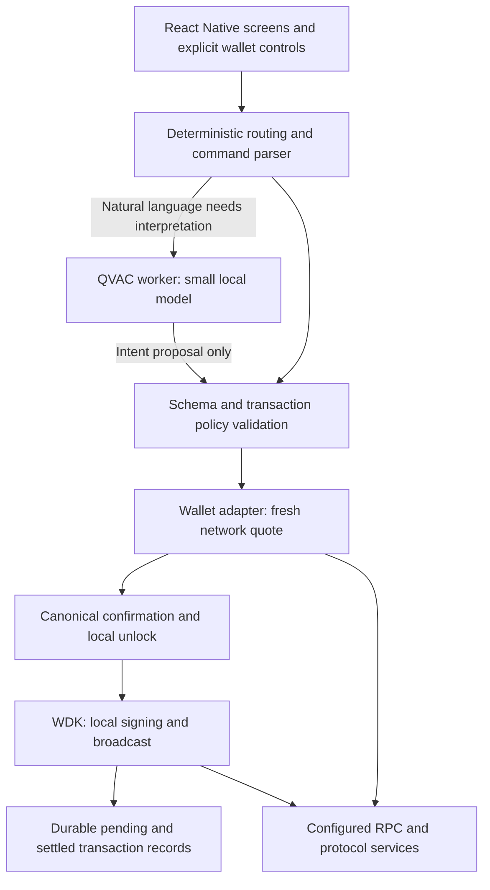

# Wally: local Android AI research and implementation brief

Research date: 22 September 2026. Target selected by the user: midrange Android phones with 6–8 GB RAM.

Status: source review and primary-source research. No Android application has been built in this task, no model has been benchmarked on a phone, and no real wallet transaction has been executed. The existing localhost demo is a scripted simulator. Recommendations and acceptance targets below are proposed engineering decisions, not measured performance claims.

## Recommendation

Use **Qwen3 1.7B Instruct, 4-bit GGUF** as the first production candidate. Benchmark **Qwen3 0.6B Instruct, 4-bit GGUF** as a lighter alternative. Evaluate **Qwen3.5 2B, 4-bit GGUF** as a challenger only after proving support in the pinned Android runtime. Choose the smallest candidate that passes Wally's command-accuracy and device-resource gates.

QVAC is the inference runtime and SDK; the model weights are a separate choice. CUDA is a backend, not a property inherent to these model weights. Android does not need NVIDIA hardware. Establish an ARM CPU baseline, then evaluate supported Vulkan/OpenCL acceleration per device; CPU-only is not automatically the most battery-efficient option. QVAC documents Android 12+, arm64, and mobile GPU options with device restrictions. Its native engine documents backend/quantization-specific optimizations, so support for one Adreno or one Q4 format does not establish support or speed on every phone. Sources: [QVAC requirements](https://docs.qvac.tether.io/system-requirements/), [native inference engine](https://github.com/tetherto/qvac-fabric-llm.cpp).

No local model uses zero system resources. A useful product promise is controlled, on-demand resource use: no inference while idle, bounded requests, unloading when appropriate, and useful wallet controls when the model is unavailable.

## Model shortlist

| Candidate | Proposed role | Why investigate it | Decision caveat |
| --- | --- | --- | --- |
| Qwen3 1.7B Instruct Q4 | Initial default candidate | Small general instruction model; QVAC documents `QWEN3_1_7B_INST_Q4` in its tool example | Must beat 0.6B on Wally's exact field extraction without exceeding device budgets |
| Qwen3 0.6B Instruct Q4 | Low-resource candidate | QVAC documents `QWEN3_600M_INST_Q4`; smallest first-round option | Ambiguous requests, references, and multi-step commands need careful evaluation; small size does not imply safe output |
| Qwen3.5 2B Q4 | Second-round challenger | Newer model with stronger results on some manufacturer benchmarks | QVAC release notes establish a 2B Q8 catalog addition; they do not prove this exact Q4 artifact/backend on target phones |
| Llama 3.2 1B Instruct Q4 | Integration control | Used in QVAC examples; useful for isolating model-specific integration issues | Separate Llama license and attribution requirements; no evidence it wins Wally's workload |
| Gemma 3 1B IT / SmolLM2 1.7B Instruct | Reserve alternatives | Additional small-model comparisons if the first round misses accuracy or latency targets | Gemma has its own terms; SmolLM2 is English-oriented; extra downloads/testing need a concrete benefit |
| Qwen3 4B Q4 | Defer from baseline | Existing repository example uses this model | Adds weight and compute cost before demonstrating a need; do not make it the minimum for a 6 GB phone |

Sources: [QVAC text generation](https://docs.qvac.tether.io/ai-capabilities/text-generation/), [QVAC releases](https://github.com/tetherto/qvac/releases), [Qwen3 0.6B](https://huggingface.co/Qwen/Qwen3-0.6B), [Qwen3 1.7B](https://huggingface.co/Qwen/Qwen3-1.7B), [Qwen3.5 2B](https://huggingface.co/Qwen/Qwen3.5-2B), [Llama 3.2 1B](https://huggingface.co/meta-llama/Llama-3.2-1B-Instruct), [Gemma 3 1B](https://huggingface.co/google/gemma-3-1b-it), [SmolLM2 1.7B](https://huggingface.co/HuggingFaceTB/SmolLM2-1.7B-Instruct).

Qwen3.5 2B is not an automatic winner. Its published comparison reports MMLU-Pro 55.3 versus 40.2 for Qwen3 1.7B, but IFEval 61.2 versus 68.2. These are manufacturer-reported benchmarks, not Wally extraction accuracy, Android speed, or results from the proposed quantized files. Qwen model cards list Apache 2.0 licensing. Check the actual redistributed artifact and include required notices. [Model card and comparison](https://huggingface.co/Qwen/Qwen3.5-2B).

Do not promise a download size or RAM requirement from parameter count alone. Record the exact GGUF revision, quantization, checksum, byte size, chat template, runtime version, context size, and backend in the benchmark manifest. Download size, resident model memory, KV cache, scratch buffers, GPU allocations, and total application memory are different quantities. Earlier rough RAM estimates were planning estimates, not phone measurements.

## What local means for this wallet

| Operation | Can work without internet? | Required behavior |
| --- | --- | --- |
| Model inference after provisioning | Yes | Verify offline startup, including model discovery/cache behavior |
| Receive address, local records, settings | Yes | Clearly distinguish local records from complete chain history |
| Prepare an intent or unsigned draft | Yes | Mark network-dependent fields unresolved or stale |
| Local key management and signing | Technically yes | Normal send flow still requires fresh network data and explicit confirmation |
| Current balances, gas, nonce, fee quotes, settlement | No | Query chain/RPC infrastructure and show freshness/errors |
| Swaps, bridging, lending state, gasless sponsorship | No | Protocol, RPC, quote, indexer, bundler or paymaster dependencies vary |
| First model install/update | Usually no | Download once, then support offline inference |

The intended design needs no central AI inference server. It still needs blockchain connectivity. When connectivity returns, refresh the quote and require a new confirmation; do not automatically send an old offline draft. Inference privacy also does not make RPC activity invisible to the selected network provider.

## Android architecture

Build a React Native / Expo native application using `@qvac/sdk` for inference and the WDK React Native integration for wallet operations. QVAC documents a Bare worker integration, and WDK publishes a React Native core/worklet approach. Use an Expo development build and a release build containing the required native modules. The final integration cannot be validated in Expo Go. Sources: [QVAC SDK](https://docs.qvac.tether.io/js-ts-sdk/), [QVAC Expo tutorial](https://docs.qvac.tether.io/tutorials/expo/), [WDK React Native quickstart](https://docs.wdk.tether.io/start-building/react-native-quickstart/), [Expo development builds](https://docs.expo.dev/develop/development-builds/introduction/).

The model gets no seed or signing capability. It proposes a typed intent; application code validates required fields, resolves explicitly chosen contacts, checks supported chain/token combinations, converts decimal strings using integer-safe arithmetic, obtains fees, and constructs a confirmation. Never use model-written prose as the authoritative recipient, amount, balance, fee or lending calculation. Treat imported text and model output as untrusted inputs.

Use deterministic buttons for balance, receive, history, and manual send. Handle exact commands directly where practical. Natural-language failure should lead to a clarification or an editable form, with no silent cloud fallback. Model self-reported confidence is not an authorization decision. Keep confirmation tied to the precise transaction parameters and quote; revalidate expiry and changed state before signing.

Use Android Keystore-backed key material to encrypt the wallet secret at rest, with an explicit unlock/recovery design. Do not copy the desktop environment-variable seed approach. Keystore protection does not mean a WDK software-signing seed never enters application memory; minimize its unlocked lifetime and keep it out of prompts, analytics and logs. Worker separation alone is not a security boundary. [Android Keystore](https://developer.android.com/privacy-and-security/keystore).

## Integration constraints to resolve first

1. **Version compatibility:** QVAC's older Expo tutorial uses older SDK/Bare versions than WDK's current mobile quickstart. WDK currently documents a Bare peer floor of 0.14.5 and Expo Crypto 55–56, while older QVAC examples use Bare 0.11.5. This is a reason to prove and pin a compatible stack, not proof that current SDKs cannot coexist. Do not resolve peer conflicts with `--force`. Run QVAC and WDK together in one physical-device smoke build before building the full UI. Sources: [QVAC Expo tutorial](https://docs.qvac.tether.io/tutorials/expo/), [WDK mobile quickstart](https://docs.wdk.tether.io/start-building/react-native-quickstart/).
2. **Android minimum:** QVAC's requirements page says Android 12+, while Expo examples set minSdk 29. Adopt Android 12/API 31 as the initial support policy until the selected SDK versions and real-device tests justify broader support. QVAC also explicitly requires physical-device testing. [Requirements](https://docs.qvac.tether.io/system-requirements/).
3. **Native packaging:** include only the QVAC LLM plugin initially, rather than every capability. Validate release-mode native libraries and 16 KB page-size compatibility across all transitive native dependencies. Sources: [QVAC Expo setup](https://docs.qvac.tether.io/tutorials/expo/), [Android page sizes](https://developer.android.com/guide/practices/page-sizes).
4. **Mobile wallet coverage:** prove the required WDK wallet/protocol calls work in the mobile worklet. Desktop MCP tools and installed DeFi packages do not establish equivalent mobile support. Any API key shipped in the APK is extractable; choose public-client-appropriate provider credentials or a narrowly scoped service where necessary. No provider service should receive signing secrets.

## Resource policy to start testing

These are proposed initial settings, not measured optimums:

- One loaded model and one active inference request. Load on demand; cancel unwanted requests; release after an appropriate idle interval or memory pressure. Do not retain a second candidate in memory for automatic comparison.
- Begin with a 2,048-token context after reducing the prompt, with 4,096 only if measured accuracy warrants it. Use only relevant recent state. The current repository's 8,192 context, five few-shot examples, conversational output and 512-token completion budget are a desktop starting point, not a mobile requirement.
- Target 128–256 output tokens for compact typed intents; detect truncation and never execute incomplete output. Validate exact schema/grammar support in the SDK instead of assuming the HTTP server's `response_format` passes through unchanged.
- Disable Qwen3 thinking through a verified supported template/runtime setting. The model card documents thinking enabled by default; merely hiding reasoning text does not avoid its compute. Verify that the desktop `reasoning_budget: false` behavior has an actual mobile equivalent. [Qwen3 model instructions](https://huggingface.co/Qwen/Qwen3-1.7B).
- Check available memory and model-fit estimates before loading. QVAC's `assessModelFit` is advisory and can return unknown; it is not a memory reservation or a performance guarantee. [QVAC API](https://docs.qvac.tether.io/reference/api/).
- Respond to Android memory pressure and thermal state. Reduce work or fall back to manual controls when constrained. Do not assume the application's usable memory equals the phone's 6–8 GB specification. Sources: [Android memory overview](https://developer.android.com/topic/performance/memory-overview), [thermal guidance](https://developer.android.com/games/optimize/adpf/thermal).
- Run interactive inference while the app is foregrounded; use appropriate scheduled work for deferred refresh/download tasks. WorkManager does not promise exact execution timing. [Android persistent work](https://developer.android.com/develop/background-work/background-tasks/persistent).

Show model download size, available storage, progress, pause/resume, deletion and an optional Wi-Fi preference. QVAC documents resumable downloads and offline loading of pre-provisioned catalog assets with matching cache configuration. Catalog files have checksum metadata; custom local paths require application-managed integrity checks. Pin trusted artifacts, verify before activation, and budget space for partial files and a replacement model. Avoid forced model downloads for basic wallet controls. [QVAC download lifecycle](https://docs.qvac.tether.io/models/download-lifecycle/).

## Changes needed from the current repository

| Current source or behavior | Android action |
| --- | --- |
| `src/qvac/client.ts`: HTTP to QVAC CLI | Replace with an on-device QVAC SDK adapter; retain a platform-neutral typed intent interface |
| `qvac.config.example.json`: 4B model, preload, context 8192 | Replace with a model manager, measured device policy and smaller initial candidates |
| `src/server.ts`: Fastify/WebSocket and cookie sessions | Move app interaction to native state/services and local wallet unlock |
| `src/wdk/server.ts`: Node MCP child process | Use WDK mobile integration; validate each required operation |
| `src/wdk/approve-runner.mjs`: Node/environment-based signing helper | Replace with the mobile wallet signing flow |
| `better-sqlite3` and server session retention | Use a mobile storage adapter; separate durable wallet records from deletable chats |
| Literal amount/address checks and confirmation flow | Extract and test domain rules without Node imports; preserve or strengthen validation |
| Mainnet overrides mixed with testnet settings | Centralize chain IDs, RPC endpoints, token contracts, pools, explorers and address rules in a validated registry |
| Bridge placeholder and incomplete lending lifecycle | Exclude from launch scope; require complete workflows before exposing them |
| Existing web layout hides chat navigation on mobile | Implement native mobile navigation and accessible confirmation screens |

These findings come from the checked-out source and the existing [local development review](LOCAL-DEV-REVIEW.md). The simulator establishes UI behavior with fictional values, not QVAC accuracy, mobile readiness or blockchain correctness.

## Benchmark and release gates

Use at least two 6 GB and two 8 GB physical phones, covering intended Adreno and Mali families where possible and the oldest supported Android version. Record SoC, OS, free memory, battery/thermal condition, build type, backend and exact model manifest. Measure release builds; simulator and desktop results are insufficient.

Create at least 500 representative commands with held-out tests: clear sends, decimal precision, pasted addresses, token/chain ambiguity, typos, corrections, cancellation, prior-recipient references, unsupported actions, malicious instructions, and requests that should trigger clarification. Include Nigerian English/Pidgin and any other language the product will explicitly support. Score exact required fields and correct abstention separately. A model that refuses everything must not pass as accurate.

| Gate | Proposed initial target or requirement |
| --- | --- |
| Supported unambiguous command accuracy | At least 98% exact intent plus required fields on held-out data; inspect per-category results |
| Critical transaction values | Zero fabricated or silently changed recipient/amount/chain values accepted in the test suite; this is a test gate, not a universal guarantee |
| User authorization | No signing without current, explicit confirmation of canonical values |
| Warm full-intent latency | Aim for p50 <= 3 seconds, p95 <= 8 seconds; measure separately from network quote latency |
| Cold startup | Report model-load and first-command latency separately; provide responsive UI throughout |
| Resource budget | Initial measured total app memory targets <= 2 GB on 6 GB devices and <= 2.5 GB on 8 GB devices; refine against real OS pressure and GPU accounting |
| Idle and thermal behavior | No continued token generation after cancellation; no sustained model compute while idle; measure energy over a fixed 20-command script and latency across 15 minutes |
| Lifecycle robustness | Repeated load/unload cycles, rotation/backgrounding, memory pressure, low disk, failed/corrupt downloads and process termination |
| Offline privacy | Provision model, restart in airplane mode, verify inference; inspect egress so no inference or prompt upload is hidden |
| Transaction recovery | Kill the process before and during broadcast; reconcile pending transactions without accidental duplicate sends |

The numeric targets above are proposed product gates. No shortlisted model has been shown to meet them in this task. Include cold/warm PSS, native allocations and relevant GPU memory; measure growth over at least 50 load/unload cycles. Keep failed and ambiguous intent rates visible alongside speed. Select the smallest passing model, not the model with the highest general benchmark score.

## Implementation order

1. **Native feasibility spike:** pin a compatible Expo/QVAC/WDK/Bare stack; run one small model and create/unlock a disposable test wallet on a physical phone; confirm offline inference and release packaging. No real funds.
2. **Domain and transaction foundation:** extract platform-neutral schemas, string/integer amount logic, chain registry and confirmation state machine. Replace desktop storage and wallet subprocess adapters.
3. **Focused wallet MVP:** one explicitly supported testnet/asset, receive, fresh/cached balances, durable history, manual send and AI-assisted send. Provide complete recovery and error states.
4. **Model selection:** compare 0.6B and 1.7B with the same context and dataset; evaluate 2B only after compatibility is demonstrated. Lock model hash and settings when gates pass.
5. **Device hardening:** low memory, thermal pressure, intermittent network, transaction recovery, release artifacts and storage/download management.
6. **Expand deliberately:** more networks and swaps after mobile protocol verification; lending only with repay/withdraw and risk-state handling; bridge only after a complete implemented flow. Voice, vision and fine-tuning are separate later decisions.

The main feasibility question is whether QVAC and WDK coexist reliably in the selected native stack and whether a small model meets Wally's extraction targets within phone budgets. Prove those early; the existing web simulator cannot answer them.